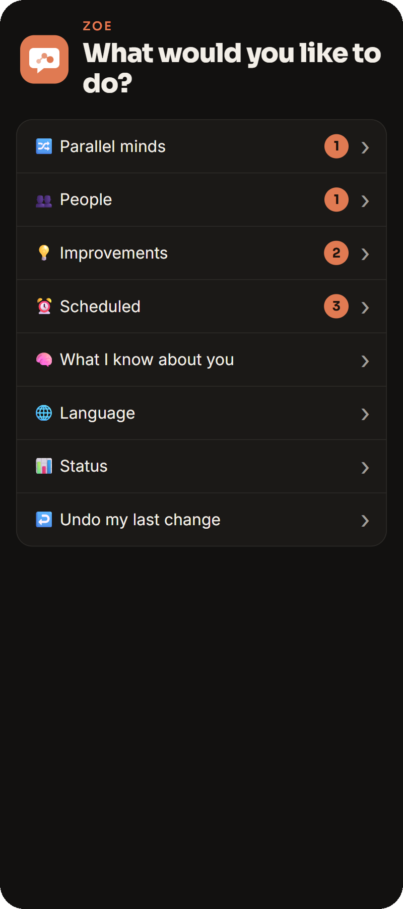
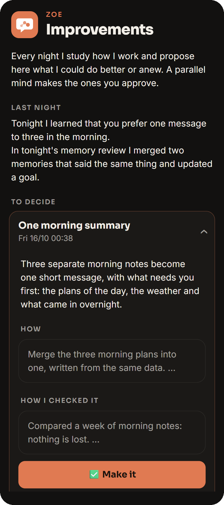
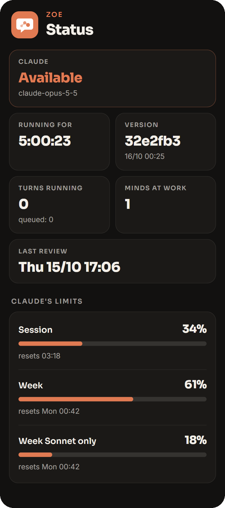
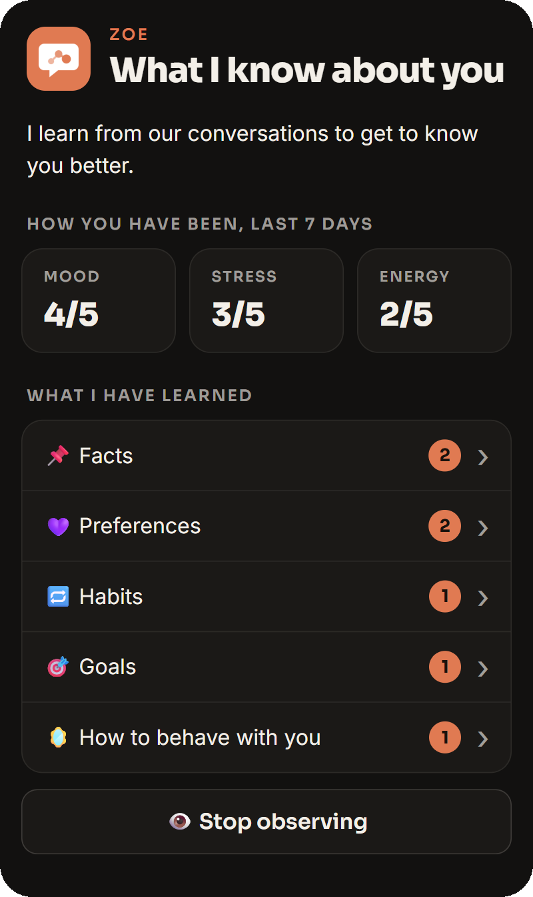
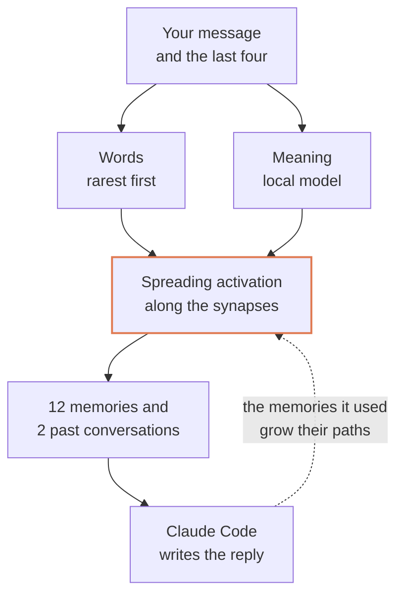
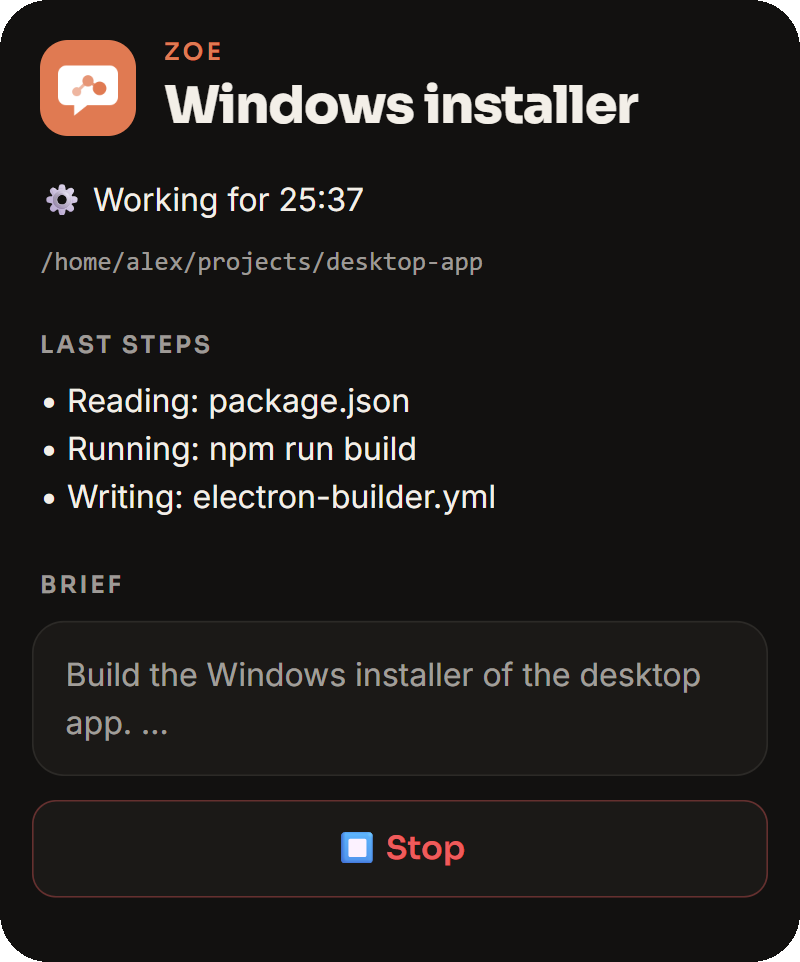
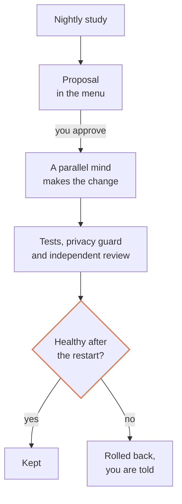

<p align="center">
  
</p>

<h1 align="center">Zoe</h1>

<p align="center">
  <strong>A personal assistant on Telegram with a brain of her own, who improves herself while you sleep.</strong>
</p>

<p align="center">
  Memory made of neurons and synapses. Changes to her own code made through tests, review and automatic rollback.<br>
  Runs on Claude Code.
</p>

<p align="center">
  
  
  
  
</p>

<p align="center">
  &nbsp;
  &nbsp;
  
</p>

---

Most assistants forget, or keep a flat list of notes. Zoe remembers the way a brain
does: everything she learns becomes a neuron, neurons that belong together are wired
together, and a thought pulls in what it is wired to. Every night she studies how she
worked and proposes what to make better; when you approve, she changes her own code,
proves the change works and rolls it back on her own if it does not.

She talks over Telegram, works on your server with the full power of Claude Code, and
owns the bridge between the two, so no message is ever lost and a stuck turn is caught
where it happens.

## A brain, not a notebook

**Every piece of knowledge is a neuron.** A fact, a preference, a habit, a goal, a
correction, a past conversation, a file worth keeping. Each is wired to the
conversation it came from, and what one conversation teaches is wired together.

**Recall spreads like activation in a brain.** A message lights up the neurons that
share its rarest words and those closest to what it means, read by a local
multilingual embedding model. Energy then flows along the synapses in proportion to
their weight; a neuron wired to everything takes little from each, so strong and
specific paths carry far. The latest messages of the chat are searched too, so a
short "how did it go?" finds what it refers to.

**Use shapes the synapses.** Every reply names the memories it relied on: the paths
that helped grow stronger, the links that pulled in what went unused fade. An
observer learns from finished conversations without slowing them, and a nightly
review, the way sleep does, merges what says the same thing, rewrites what changed
and forgets what was never lasting.

<p align="center">
  
</p>



### Measured, not guessed

Zoe measures her own memory. Claude judges once what a sample of real messages
needed; recall is then replayed against memory as it was at each message, and the
score is how much of what was needed comes back. The nightly study reads it every
night, and a new sample is judged every two weeks.

On the author's installation, on 48 to 56 judged real messages:

| Recall | Needed memories found |
| --- | ---: |
| Keyword search ranked by popularity | 4% |
| Full-text search, spreading normalized by link strength | 28% |
| Search by words and meaning, lasting memories first | 46% |
| The chat's latest messages searched too, twelve places | **58%** |

Each step was kept only because the measure went up; ideas that did not move it,
such as a layer of concept neurons, were left out.

## She improves herself

**Every night she studies how she works.** A run with the owner's powers reads the
last days: where she had to be corrected, what was asked by hand again and again,
what broke. She changes nothing that works and proposes at most two improvements,
each with what changes for you, how to make it and how it was checked.

**One tap makes it.** An approved proposal goes to a parallel mind, which changes
her code or her skills while the chat stays free.

**Every change goes through one pipeline.** It is made in its own git worktree, never
in the live files. It must pass the full test suite and the privacy guard, then an
independent review by a second Claude that rejects patches, special cases,
duplication and untested behavior. She restarts only when no work is in progress,
and trusts the new version only once it has proved itself healthy for 90 seconds;
otherwise the last good version comes back on its own and you are told. Any change
can be undone from the menu.

**Her foundations are protected.** The launcher, the pipeline, permissions, the
vault and the privacy guard change only when you explicitly ask.

<p align="center">
  
</p>



## And everything a personal assistant needs

| Capability | In practice |
| --- | --- |
| **Never loses a message** | Every message is stored before anything else touches it; a stuck turn is stopped and retried. |
| **Works beside the chat** | Long jobs run as parallel minds; plans come due at a time or on a cron rule. |
| **Asks before acting for you** | Writing to someone else, publishing or spending waits for a yes on Telegram. |
| **Speaks and listens** | Voice notes both ways, with a speech recognizer that learns your names and words. |
| **Handles every file** | Photos, documents, albums, video and voice, kept for good when they matter. |
| **A menu in Telegram** | A Mini App for minds, plans, people, improvements, memory and status. |
| **Several people, private memories** | Owners and members, each with their own memory and permissions. |
| **Two languages** | English and Italian, chosen per chat. |

## Getting started

You need Python 3.11 or later, the Claude Code CLI installed and signed in on the same
machine (`claude` on the PATH, with a subscription or an API key), a Telegram bot token
from [@BotFather](https://t.me/BotFather) and your Telegram user id. ElevenLabs for
spoken replies and the Whisper server for voice notes are optional.

```bash
git clone https://github.com/0xDevDav/zoe.git && cd zoe
pip install -e ".[meaning]"           # recall by meaning; without it recall goes by words alone
pip install -e ".[voice]"             # only where the Whisper server runs
mkdir -p ~/.zoe && cp .env.example ~/.zoe/.env   # set ZOE_OWNER_IDS
python -m zoe.meaning                 # downloads the meaning model, about 330 MB
zoe-vault set telegram bot_token --kind token
zoe-run                               # the service, kept alive and rolled back by the launcher
```

Memory starts empty and fills itself: the observer learns from your conversations,
the nightly review sorts what was learned, and once 40 messages have been written the
nightly study judges the first recall sample and starts measuring.

For a server, `deploy/` holds the systemd units with the reasons for every setting.
The menu needs an HTTPS address in `ZOE_MENU_URL` behind a reverse proxy; Telegram's
long polling needs no open port.

### Your plan, your terms

Zoe drives the official `claude` CLI as Anthropic publishes it and never reads, stores
or passes on your Claude credentials: you sign in through Anthropic's own flow, and
each installation runs on its owner's subscription or API key. A Free, Pro or Max plan
comes under the [Consumer Terms](https://www.anthropic.com/legal/consumer-terms), with
limits meant for ordinary individual use, so it suits Zoe as your own assistant.
Offering Zoe to other people as a service comes under the
[Commercial Terms](https://www.anthropic.com/legal/commercial-terms) and needs API key
authentication: a claude.ai login may not serve anyone else's requests. See Claude
Code's [legal and compliance](https://code.claude.com/docs/en/legal-and-compliance)
page and the [Usage Policy](https://www.anthropic.com/legal/aup). Each user is
responsible for using Zoe within Anthropic's terms.

## Learn more

[Zoe in depth](docs/GUIDE.md) is the full guide: people and access, the menu, the
writing standard, plans, parallel minds, the observer, recall, self-improvement,
security, credentials, privacy, voice, deployment and the layout of the code.

Each file in `tests/` is a plain script with no framework; run them all with
`for t in tests/test_*.py; do python "$t"; done`.

## License

Zoe is released under the [MIT License](LICENSE). The fonts in `zoe/theme` come under
the [SIL Open Font License](zoe/theme/OFL.txt). The meaning model Zoe downloads,
EmbeddingGemma by Google, is not part of this repository and comes under the
[Gemma Terms of Use](https://ai.google.dev/gemma/terms); it is fetched from one fixed
revision, with every file checked against its SHA-256.
