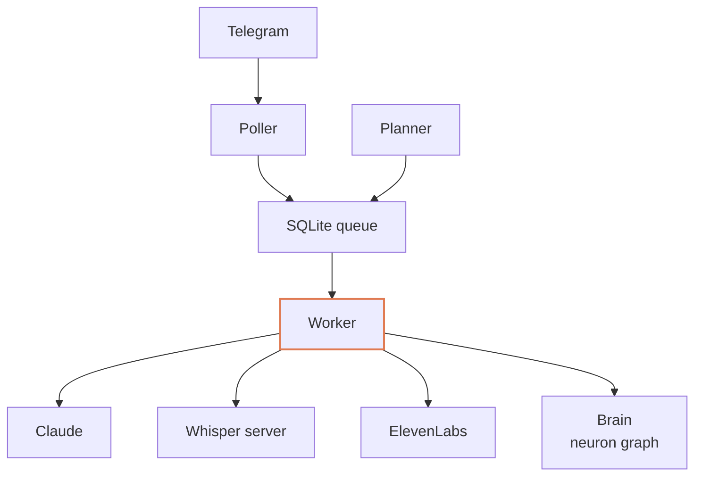

# Zoe in depth

How Zoe works, part by part: what each piece does, the rules it follows and why. The
[README](../README.md) is the short tour; this guide is the reference.

## How it works



- **Poller** long-polls Telegram and writes every inbound message to SQLite
  before anything else touches it.
- **SQLite queue** holds each message with a state (`received`, `processing`,
  `answered`, `failed`). A message left `processing` by an interrupted run is
  returned to the queue at startup.
- **Planner** puts each plan in the queue of its chat when it comes due.
- **Observer** reads finished conversations beside the chat and stores what
  they show about each person.
- **Parallel minds** carry long work beside the chat and send their news back
  through the queue.
- **Worker** takes one message at a time: it transcribes voice notes, builds a
  prompt from recent history and recalled neurons, runs Claude under a timeout,
  replies as text or voice, and records what was learned. Because the worker
  starts Claude, it knows when a turn is stuck and stops it.
- **Brain** is the neuron graph: it stores knowledge, wires neurons that fire
  together, and recalls by spreading activation.

## People, accounts and access

Zoe works the same for one person, for one person on several accounts, and for
several people.

- A **person** is someone Zoe knows, with a role, a language and a memory.
- An **account** is one Telegram identity. Several accounts can belong to the
  same person, who stays one person to Zoe with one memory.
- **Memory is private per person.** Each neuron belongs to a person or to the
  shared space. A person's recall reaches their own neurons and the shared ones;
  activation never flows into someone else's memory.

| Role | What a turn may do |
| --- | --- |
| owner | everything Zoe can do on the machine, in the owner's working directory |
| member | conversation, web search and reading the files they send, in a private directory that file reading cannot leave, without the owner's settings, instructions, files, commands or connected services |

Access is closed. The owner's accounts come from `ZOE_OWNER_IDS`, and nobody
else gets an answer until the owner lets them in:

- someone not admitted gets no reply at all, and the owners get no notice, so
  the bot looks switched off to strangers and cannot be used to flood the owner;
- the owner admits an account by asking Zoe with its Telegram id ("add
  123456789", optionally with a name): with the name of a member already known,
  the id becomes another account of theirs. The receipt has a button that blocks
  the account again. A forwarded message shows its sender's id when the
  sender's privacy allows it;
- the last 50 accounts that tried to write are remembered without answering
  them, and the owner can admit or block them from the menu;
- in the menu the owner adds a member's account by its Telegram id, removes an
  account, or removes the whole person: their accounts can no longer write,
  and what Zoe knows about them stays, for when they are added again. The
  owner's own accounts are only shown there, never changed;
- the owner can let a member read a folder of theirs by asking Zoe
  (`[[KEY share: Name | /folder]]`, taken back with `unshare`): the member's
  turns can then read it, and only read it, besides their own folder. Zoe's
  home, her code, the root of a disk and the home folder itself are never shared.

## Menu

The menu is a Telegram Mini App (`menu.py`, served by `webapp.py`), so the chat
keeps only the conversation. The chat's Menu button opens it, and `/menu`
(`/start` once approved) answers with a button that does the same. Everyone can
change language, see or delete what is scheduled for them and see what Zoe has
learned about them. Owners also follow and stop parallel minds, manage people
(one person open at a time, the owner first, each with their accounts) and who
tried to write, decide what Zoe proposes to improve, undo her last change to
herself, and see her status as cards: since when she runs, version and model,
whether Claude can work, turns running and queued, parallel minds at work, the
last nightly review, and Claude's usage limits (the 5-hour session and the
week, how much is used and when each resets). Every Claude run reports the
limits along with its requests, and the status shows what the latest run
reported. When that is more than five minutes old, as after a start or while a
long mind works alone, Claude Code's own `/usage` is read too, without a model
call; a reading runs in the background only while someone looks at the status,
at most once every five minutes, and the newer of the two shows. Owners
open the status straight away with `/stato` (or `/status`).
Every view asks for fresh data each second and is drawn again only when
something changed, never while a field is being written in; running times, such
as a mind's work or Zoe's uptime, tick every second against the server's
clock. What removes or blocks asks for a confirmation, and everything acts
immediately, even while a turn is running.

- Telegram opens Mini Apps only over HTTPS. `ZOE_MENU_URL` is the menu's public
  address, which a reverse proxy with a certificate forwards to
  `127.0.0.1:ZOE_MENU_PORT` (8791 by default). Without an address, `/menu` says
  the menu is off.
- The page, its script and its theme are public. The API answers only requests
  carrying the data Telegram signed with the bot's token when it opened the
  page, signed less than a day before, for an approved account, and owner-only
  views and actions are checked on every request. Everything the page shows is
  set as text, never as markup, so nothing a memory or a name holds can run in it.
- The page has Zoe's look, which comes with her in `zoe/theme`: dark warm
  surfaces, an orange accent, Sora for titles and Inter for text, and her logo.
  An installation gives it a look of its own with `ZOE_HOME/menu/theme.css`,
  which sets the page's colour, font and radius variables and may show a logo;
  the fonts and images it uses sit beside it.

With Caddy, for example:

```
example.org {
    handle /zoe/app* {
        reverse_proxy 127.0.0.1:8791
    }
}
```

At every start Zoe brings her Telegram profile in line with the installation,
changing only what differs: name, descriptions in each language, profile photo
(Zoe's own, or `ZOE_HOME/avatar.png` when the installation has one), the single
`/menu` command and the Menu button, which opens the menu.

Claude Code adds the signed-in account's email to every session it starts.
Members are told never to share anything about the owner; the address is kept
from them by that instruction rather than by a technical barrier.

## Writing standard

Replies are written for a phone screen, and the standard is part of the product
rather than per-installation instructions. Every text turn receives it
(`style.py`), and `formatting.py` enforces its mechanical rules on every reply,
whatever the model writes:

- the answer comes first, in one line, then short blocks separated by a blank line;
- section titles in bold with one emoji in front; anywhere else an emoji ends its line;
- lists with `•`, bold only on what matters, italics for side notes, code for ids and paths;
- no tables and no `#` headings: they become titles and lists;
- no long dash or en dash;
- Telegram HTML only, including expandable quotes for long details; Markdown is
  converted, unknown tags are escaped, and broken markup never reaches Telegram;
- replies longer than one message are split at block boundaries.

A progress message appears as soon as Zoe takes a message, before she downloads
what was sent or hears a voice note, and workers are woken the moment a message is
queued. It shows what is happening now: the state (listening, downloading,
working, thinking, writing the answer, or recording it when it will be a voice
note) with the elapsed time, and below it the
action in progress on one line, with an icon for its kind (a command, a file read,
a web search, and first of all 🧠 with what she remembers for the message). Each
new action replaces the one before. When the answer is ready,
the progress message becomes the answer, so it appears where the person is already
looking. A voice answer, or one that replies to a quoted message, arrives as a new
message instead, and the progress message is removed.

Buttons are coloured by what they do: red for what removes or blocks (undoing,
stopping, forgetting, deleting, blocking, refusing), green for admitting someone
and for the option chosen, blue for the options of a question.

## Messages written during a turn

Messages sent one after another are one turn: those already waiting when a turn
starts are answered together, in a single reply. A message written while Zoe is
working is usually a correction or an addition, so:

- the progress message is deleted and sent again below it at once, so the work
  in progress is always the latest message in the chat;
- once the person pauses for a moment, and as soon as no command is running (a
  command is never cut in half), the turn stops and its Claude session resumes
  with the new messages: Zoe keeps what she had done, adjusts to what
  changed, and writes one reply that covers everything;
- if the turn fails, the messages it took in go back to the queue.

Plans and news from parallel minds run to the end without taking messages in.

## Directives

Claude acts on the service by adding directives to a reply, which are removed
before it is shown (`directives.py`). Each turn gets a random key that only its
instructions hold, and a directive counts only with that key: `[[KEY react: 👍]]`.
A web page, an email, a file or a message Zoe reads cannot know the key, so a
directive written there and repeated in a reply stays plain, visible text and
does nothing. Directives inside code never act either.

Whatever a reply sets in motion (plans made or cancelled, files kept or deleted,
people admitted) is listed after it in a silent receipt written by the service,
not by Claude, with a button that undoes it at once. Parallel minds are
followed and stopped from the menu instead.

A block directive acts when its opening and closing lines are outside code, so
a mind's brief may quote code freely.

## Reactions and choices

- `[[KEY react: 👍]]`: when a message needs no written answer Zoe reacts to it
  instead, and she can add a reaction to a written reply when one fits; reactions
  stay within a friendly subset of the ones Telegram accepts.
- `[[KEY options: PDF | Excel | Both]]`: when the person must pick among fixed
  alternatives, the question arrives with one button per option. The tapped one
  stays shown under the question and comes back to Zoe as the person's next
  message, so she carries on knowing the choice; writing an answer still works.

## Messages and replies

Every message, the person's and Zoe's, is kept with its Telegram number. A long
reply split into parts is kept part by part. Zoe sees the numbers in the
conversation and in her memories.

- When the person replies to a message, quoting all of it or a part, Zoe gets
  that message and when it was sent, even when it is long gone from the recent
  conversation, and recall starts from it.
- Zoe answers a specific message, hers or the person's, with `[[KEY quote: 4521]]`,
  to bring something back to mind. Only messages of the same chat can be quoted.
- Zoe changes one of her own earlier messages with `[[KEY edit: 4521]]` (a list
  to update, a figure to correct): her reply becomes its new text, and a short
  note answering it shows where it is. A message that cannot take the reply (not
  hers, a voice note, a reply longer than one message) gets a new message instead.

## Plans

Zoe does things later, once or on a schedule: a reminder, a question to follow
up on, a daily report. Plans live in her memory rather than in a separate list
of timers.

- A plan is a neuron holding Zoe's instruction to herself, private to the person
  it is for and wired to the conversation it came from. It is due at a local
  date and time, or follows a five-field cron rule when it repeats, in the
  server's time zone.
- Claude makes one with `[[KEY plan: 2026-10-14 09:00 | Ask how the walk went]]`
  and cancels one with `[[KEY unplan: 12]]`. Every turn sees the current time and the
  person's pending plans.
- A due plan joins its chat's queue and runs as an ordinary turn: in order with
  the chat's messages, with the person's powers, without a progress message.
  If Zoe is answering something, the plan waits, then she writes it herself
  right after that conversation, bringing it in naturally.
- Recall starts from the plan's neuron, so Zoe knows why she made it. What she
  sends stays in the chat log and in her memory, wired to the plan: a repeating
  plan remembers its earlier runs, and a later reply to the message leads back
  to the plan.
- A run with nothing worth sending ends with `[[KEY skip: reason]]`: the person gets
  nothing, and the reason is remembered for the next run.
- A plan is not lost. Plans live in the database, so they survive restarts, and
  a plan that came due while Zoe was off runs once when she starts. Telegram
  calls that fail for a passing reason are retried, and so is a failed turn. If
  every try fails, the plan's own instruction reaches the person as it is.
- Everyone sees and deletes their own plans from the menu. A repeating plan
  runs at most every 10 minutes, a member's at most every hour, and a member
  has at most 20 pending plans.

## Parallel minds

A turn holds its chat until it ends, so long work does not run in a turn. When
a request would take long, such as building a site or a program or a large
piece of research, Zoe answers at once and hands it to a parallel mind: a
separate Claude run with her powers, in its own folder, allowed hours rather
than minutes. The chat stays free, and the owner can ask her anything else.

- Zoe writes the brief with `[[KEY mind: Title | folder]] ... [[/mind]]`: the goal,
  where to work, constraints, and how to verify the work. The mind does not see
  the chat, so the brief carries everything it needs, and its first prompt adds
  what Zoe remembers about the task.
- Up to `ZOE_MINDS` minds work at once; the others wait their turn.
- A mind works only with the owner's own Claude settings, never with those of
  the folder it works in: a downloaded project's hooks, MCP servers and
  environment would otherwise act with the owner's powers before the mind read
  a single file of it. A mind never works in the root of a disk, in the home
  folder itself, in Zoe's code (which changes only through her pipeline) or in
  her home outside the minds' folders: it gets a folder of its own instead. Two
  minds never work in the same folder, or in one inside the other, at once.
- Every mind is kept in the database with its Claude session. After a restart a
  mind resumes its own session where it was, instead of starting over, and a
  run that fails is resumed once before it is reported.
- Every turn shows Zoe which minds are working, for how long and on what step,
  so she answers "how is it going?" without disturbing them.
- `[[KEY tell: 3 | text]]` passes a note to a working mind: the run is interrupted
  and resumes its session with the note, and the person's message gets a ✍.
  `[[KEY stop: 3]]` stops it.
- A mind that needs a decision ends with `[[KEY ask: question]]`. The question
  reaches Zoe in the chat, she asks the person, and the answer resumes the mind.
- When a mind finishes, fails or asks, the news joins its chat's queue like a
  plan: it waits for the turn in progress, and Zoe tells the person in her own
  words. The task is a neuron wired to the conversation it came from, and a
  reply to the news leads back to it.
- A mind never writes to the chat itself, even when its brief asks: its report
  gives the full path of every file to show, and Zoe sends them with the news,
  so whatever the person sees passes through her and stays in the chat log.
- A mind plans its work in a few phases with `[[KEY phases: Read | Write | Test]]`
  and marks the one it starts with `[[KEY phase: 2]]`; when a fix needs a phase
  of its own, it writes the whole list again. A task of a few minutes plans none.
- In the menu, "Parallel minds" lists the minds at work, each with its state, for
  how long and what it is doing, and the last ones that ended. A mind that
  planned its phases shows a bar of how far it is and the phase it works on. A
  mind's page shows its folder, its phases ticked off, last steps, brief and
  result, and stops it. While minds work
  the chat gets nothing from them but their news.
- Only owners start minds.

## Observer

Zoe learns about the people she talks to without slowing the conversation. The
observer is a separate thread that reads finished conversations, once they
pause or every 30 messages, with its own Claude run that has no tools and
cannot message anyone: its answer is data.

- **Signals** are readings over time: how the person seems (mood, energy,
  stress, from 1 to 5, with a note saying why), each dated to the message it
  shows in. Devices will write their readings to the same table, so everything
  measured about a person can be compared over time.
- **Memories** are lasting facts, preferences, habits and goals, plus feedback
  on how Zoe should behave with the person. Each becomes the person's neuron,
  wired to the conversation it came from. One that corrects a known memory
  revises it instead of adding a copy, and one already known is reinforced.
- **Reactions** the person puts on Zoe's messages are kept in the chat as
  messages that need no answer, naming the message they react to, so the
  observer reads how each message landed and the next turns see it too.
- **The nightly review** (`ZOE_REVIEW_AT`, 03:00 by default) sorts what was
  learned, the way sleep does. A Claude run with no tools reads the day's
  conversations with everything known about the person, adds what the observer
  missed (above all a correction, something the person confirms or already
  knew, how a tool they use really behaves), merges items that say the same
  thing into one that keeps the links of all, counts as known since the oldest
  and is where the others now lead, rewrites what is unclear or no
  longer true, and forgets what was never lasting. Memory is knowledge, not
  behavior, so the changes apply at once; each review is written to
  `ZOE_HOME/reviews` with what every change replaced, and its one-line summary
  shows in the owner's menu, under Improvements. Weak links are then pruned.
  `python -m zoe.review` runs one now.
- Every turn sees how the person has been lately and the most salient things
  learned about them.
- Owners are observed unless they turn it off; anyone else only once they or an
  owner turn it on. In the menu, "What I know about you" shows the readings and
  everything learned, lets the person delete any of it, and switches their
  observation on or off.

## Recall

Every turn shows Zoe up to twelve lasting memories (facts, preferences, habits,
goals, feedback, kept files) found for the message, and at most two past
conversations: the chat history already holds the recent ones, and older ones
mostly carry recall along to the memories they are wired to.

- recall starts from the neurons that share the rarest words with what was said
  and from those closest to what it means, a neuron high in both rankings first,
  and from the plan, task or message the turn comes from. The last four messages
  of the chat are searched too, at half the energy: they give a short message
  such as "how did it do that?" its sense. Energy flows along
  links in proportion to their weight, so a neuron wired to everything takes
  little from each;
- meaning comes from a small multilingual embedding model, EmbeddingGemma, run
  on the CPU: "a dollar in euro" finds "USD/EUR rates". Each neuron is placed
  once, when a search first needs it, and again when it changes;
- the memories come with their numbers, and the reply names those that shaped it
  with `[[KEY used: 12, 45]]`. What a reply used is wired together and to the
  conversation, and the links that pulled in what went unused alongside it
  weaken: paths that help grow, the others fade until the nightly review prunes
  them.

How well recall works is measured, not guessed. `python -m zoe.recall_eval build`
has Claude judge, once, what a sample of the owner's real messages needed, kept
in `ZOE_HOME/recall-set.json`; `python -m zoe.recall_eval` replays them against
memory as it was then and tells the share of it that comes back, by recall and
by search alone. The nightly study sees the score every night and judges a new
set every two weeks, so it covers the memories made since; a set judged anew
every night would be no yardstick. The first set waits for 40 messages written
since memory began, so it is not judged on a handful.

## Self-improvement

Zoe changes her own code and skills, and the base is built so that years of
changes leave a cleaner system rather than a pile of patches.

- **Skills are her functions.** Each one is a self-contained folder with its
  instructions, scripts and tests, loaded by Claude Code as a plugin. Skills made
  for this installation live in a private plugin in `ZOE_HOME`, which is its own
  git repository; generic skills live in the built-in plugin under `plugin/`.
  Adding a function means adding a folder; removing it means deleting the folder.
- **She learns by changing herself.** When the owner asks her to learn something
  or to work differently, the change goes into her code or skills, never into a
  separate script or a written rule that works around her. Long changes run as
  a parallel mind.
- **She proposes what to improve.** Once a night (`ZOE_IMPROVE_AT`, 03:30 by
  default) a run with the owner's powers studies the last days: where the owner
  had to correct or guide her, what they asked by hand again and again, what
  broke. It changes nothing that works and proposes at most two improvements,
  each with what changes for the owner, how to make it and how it was checked;
  the owner's standing instructions may say what else to study. In the menu,
  "Improvements" shows last night's findings and the proposals: one tap hands a
  proposal to a parallel mind that makes it and reports in the chat, another
  sets it aside for good. `python -m zoe.improve` runs a study now.
- **Every change goes through one pipeline** (`zoe-evolve`, on the PATH of owner
  turns and parallel minds): it is made in its own git
  worktree, never in the live files; it must pass compilation, the full test
  suite and the privacy guard; an independent review by a second Claude judges
  it against `plugin/skills/self-improvement/PRINCIPLES.md` and rejects patches,
  special cases, duplication, dead code and untested behavior; then it lands as
  one squashed commit.
- **Skills take effect at the next turn; core changes after a graceful restart**,
  done once no turn is waiting or running and no parallel mind is working, so a
  change never cuts work short. The launcher (`python -m zoe.launcher`) restarts
  the service and trusts a new version only once its heartbeat proves it works:
  every part alive and Telegram read, for 90 seconds; staying up is not enough,
  since a version can run deaf. A version that fails before proving itself is
  replaced by the last one that did, with uncommitted changes stashed, the
  failed one kept on a branch and the owners told; one whose heartbeat stops or
  reports a part gone later is stopped and started again. Schema changes only
  add tables and columns, so an older version always runs on the newer database.
- **Every change can be undone** from the menu, with a confirmation.
- The launcher, the pipeline, permissions, the vault, the privacy guard, their
  tests and the principles change only on the owner's explicit request.

## Security

Zoe holds the owner's machine and memory, so the guards sit in the code, not
only in instructions:

- **Directives need the turn's key** and leave a receipt with an undo button
  (see Directives).
- **Access is closed** and **an owner's accounts come only from
  `ZOE_OWNER_IDS`.** Strangers get no answer; an admitted account becomes a
  new member or joins a member, never an owner, so someone posing as the owner
  cannot get the owner's powers.
- **Members are confined.** Their turns run in safe mode and restricted mode:
  web search, web pages and reading the files they sent in their own folder,
  nothing else. No owner settings, instructions (not even a `CLAUDE.md` in a
  parent folder), skills, hooks, plugins, MCP servers or memory, and reading is
  not pre-approved, so nothing outside their folder can be read. As each turn
  starts, the service checks the tools Claude came up with and stops the turn
  before it acts if there is anything more, telling the owners.
- **Some actions wait for the owner's yes.** `ZOE_HOME/ask.json` lists Claude
  Code permission rules for what must not happen unasked, such as writing to
  other people, publishing or spending:
  `["Bash(git push *)", "mcp__whatsapp__send_message"]`. Owner turns and
  parallel minds run with them as `permissions.ask`, so Claude Code's own rule
  matching decides, and with `approve.py` as their PermissionRequest hook: the
  question reaches the chat with what is about to happen and Allow and Deny
  buttons, and the action waits up to 10 minutes for a tap. No answer, a
  member's tap, or a run with nobody to ask, such as the nightly study, means
  no, and Claude is told not to try another way. The rules match the command
  as written, so they guard against mistakes, not against a determined program.
  A guard of the owner's own, a PreToolUse hook that decides by itself what
  needs a yes, asks the same way by passing its input to `python -m zoe.approve`,
  which answers as a PreToolUse decision.
- **A blocked account goes silent at once:** its plans are cancelled and its
  waiting messages set aside.
- **Prompts travel through stdin**, never on the command line, where they would
  be capped and readable by every local user.
- **Parts that fail come back.** An update that fails is retried and, if it
  keeps failing, set aside with a notice to the owners; a worker survives any
  error in a turn; a part of the service that stops makes the whole service
  exit, and the launcher starts it again.
- **Work is not repeated.** A turn that runs too long or goes silent resumes
  its own Claude session on the next try, told to check what is already done
  before doing anything again, instead of starting over. Silence while a
  command runs (a build, an install) is work, not a stuck turn, for up to 20
  minutes. A reply whose delivery failed is delivered again on the next try
  without running Claude again, and due plans are queued in one transaction.
- **A wait never holds the chat.** A turn that answers while its background
  tasks still run (a print, a render, a download) sends that answer at once and
  frees the chat; its session is followed on, silent for as long as the tasks
  run, up to `ZOE_CLAUDE_BACKGROUND_TIMEOUT` (four hours), and what Claude says
  when they end reaches the person as a further reply. A requested restart
  waits for such a session only while it replies or runs a command: one that
  only waits for its tasks is ended by the stop, and a plan due at once, with
  what it waited for and the commands behind it, takes the waits up again after
  the start. A command left in the foreground
  holds the turn for two minutes at most: Claude Code then moves it to the
  background, where it is followed the same way.
- **When Claude cannot work at all** (logged out, out of usage), which its own
  error says, never what a turn wrote: turns go back to the queue without
  counting as attempts, and working parallel minds go back to theirs with
  their session, without spending their retry. Nothing starts again before
  the retry moment: when a usage limit resets, as its error says ("resets
  6pm"), otherwise a minute later. The owners hear it once, with the time
  Zoe resumes or the reason, then again when Claude is back
  (`availability.py`).
- **Long messages cannot flood the memory:** a message teaches the speech
  glossary at most 15 words, pasted code and logs none.

## Messages and memory are never fought over

- **One Zoe per home.** The service holds a lock on `ZOE_HOME/zoe.lock` while
  it runs, and a second one refuses to start, so two services never split the
  bot's messages. If something else reads the bot's updates with the same
  token, Telegram reports a conflict and the owners are told, at most once an
  hour.
- **One turn per chat.** Messages are claimed from the database one chat at a
  time, a turn takes in only its own chat's messages, and a turn that fails
  gives them back. Parallel minds and the observer never take chat messages:
  they read the database and add their news to the queue.
- **No Claude process outlives its work.** Every turn, mind run and observation
  is one `claude -p` process that exits when it ends, and whatever it left
  running in its process group is stopped with it. A mind waiting for an
  answer holds no process: its session waits on disk and resumes when the
  answer comes. Turns and runs are stopped when they exceed their time or stay
  silent too long.
- **Bounded parallel work.** At most `ZOE_WORKERS` turns, `ZOE_MINDS` minds and
  one observation run at once. A mind starts only while the system has
  `ZOE_MIND_MIN_FREE_MB` of memory free, and two minds never work in the same
  folder at the same time.

## Chats in parallel

Each message carries the chat it came from, and its reply goes back there. Each
chat is served one message at a time, in order; different chats are served in
parallel by `ZOE_WORKERS` workers. Only private chats are handled.

## Everything Telegram can carry

Zoe reads whatever is sent to her, not only text (`content.py`):

- **Files** (photos, documents, videos, GIFs, audio, stickers) are saved in the
  person's `inbox` folder, one folder per day, under names that cannot leave
  it, each with a number. Claude opens them from there: images and PDFs
  directly, other formats with the owner's tools. Videos, GIFs and video
  stickers also get one image of four frames spread over them, left to right
  (made with `ffmpeg`), so Claude sees what happens in them; round video
  messages and animated stickers, or any of them when no frames can be made,
  get their preview image. Telegram gives
  bots files up to 20 MB; a bigger one is described but not saved. What happens
  to them next is under Files.
- **Sound** in voice notes, audio and round video messages is transcribed.
- **Locations, places, contacts, polls and dice** are written out, places with
  a map link. A live location is read once; its moves are not new messages.
- **Albums** arrive as separate messages and are read as one turn.
- **Formatting** in texts and captions (bold, code blocks, hidden links,
  quotes) reaches Zoe as Markdown. Telegram sends it apart from the text, as
  offsets counted in UTF-16 units, so read as plain text a link would lose its
  address and a pasted code block its edges.
- **Rich messages** (headings, lists with checkboxes, tables, quotes, code,
  details, maps) reach Zoe as Markdown too, custom emoji as their plain emoji.
  The media inside one are named with their caption but not saved.
- A **forwarded** message says who it comes from, and an **edited** one which
  message it changes. Captions travel with their file.
- A message is read once: its files and transcript are kept, so a retried turn
  does not download or transcribe again.

## Programs that write in Zoe's name

Scripts on the machine (an alert, a report, a reminder of their own) do not talk
to Telegram on their own: they hand the message to Zoe's outbox with `zoe-say`,
and the service delivers it and logs it in the chat, marked with the program's
name. Zoe knows what was said in her name, and the person can answer it or
quote it. A message waits in the outbox while the service is down, and one that
keeps failing is set aside after five tries.

```
zoe-say "text"                               # to the owner's first account
zoe-say --chat 123456789 --from pec "text"   # to a chat, naming the program
echo "text" | zoe-say -                      # text from stdin
zoe-say --file report.pdf "caption"          # a file
zoe-say --file note.ogg --kind voice         # a voice note
zoe-say --silent "text"                      # without a notification sound
zoe-say --options "Yes|No" "text"            # with one button per option
```

With `--options` (up to eight labels, text messages only) the buttons sit under
the last part of the message, as with the choices Zoe offers herself: a tap
reaches Zoe as the person's next message, as if they had written the label.

Coming from claude-telegram-supercharged, `tools/import_supercharged.py`
brings its chat history and speech glossary in.

## Files

Disk space is not endless, so a received file is temporary unless it is worth
keeping (`files.py`):

- every saved file is deleted after `ZOE_TEMP_FILE_DAYS` (7 by default): a
  screenshot shown in passing does not stay;
- Zoe keeps what the person will need again (documents, contracts, receipts,
  anything they ask her to keep) with `[[KEY keep: 12 | what it is]]`. A kept
  file has no expiry and becomes a neuron holding what it is, wired to the
  conversation it came with, so it is found months later by what it is about;
- when Zoe moves a kept file, for example into the owner's archive, she gives
  its new place with `[[KEY keep: 12 | what it is | /new/place]]`, and recall
  shows where it is now;
- `[[KEY discard: 12]]` deletes a file at once, and every keep comes with a
  receipt whose button deletes it;
- deleting is careful: only files still in an `inbox` folder are ever deleted
  from disk; a file moved anywhere else is only forgotten;
- `[[KEY send: 12 | caption]]` or `[[KEY send: /path | caption]]` sends a file to
  the chat, again by its Telegram id when Telegram has it, otherwise uploaded,
  up to Telegram's 50 MB. Several files separated by commas arrive together as
  albums of up to ten, logged in the chat like any file: photos and videos as
  such, or all as documents when one is neither. `| file` at the end sends them
  uncompressed, as documents, when the originals matter. A member keeps and
  sends only files in their own folder.

## Voice

- **In**: a standalone Whisper server (`zoe-whisper`, faster-whisper) keeps the
  model in memory; the worker sends it the audio of each voice note.
- **Out**: when the user speaks, or asks in writing to hear the answer
  (`[[KEY voice]]`), Zoe answers with a voice note generated by ElevenLabs
  (`eleven_v4` by default), with its text as the caption to read again, falling
  back to text if synthesis fails. While it is made, the progress message says
  it is recording and Telegram shows "recording a voice message". Words are
  said the way `ZOE_PRONUNCIATION` spells them (a file of `Word = how to say it`
  lines, read at every voice note).

### A recognizer that learns your words

Whisper mishears what it has never seen: names, brands, jargon. Zoe keeps those
words as `term` neurons and builds the recognizer's glossary from them before
every transcription.

- Unusual words in typed messages (mixed case, acronyms, proper nouns, words with
  digits) are reinforced each time they appear and wired to the words around them.
- After a voice note, Claude reports words it believes were misheard; Zoe stores
  each misheard form as an `alias` neuron linked to its term and fixes it in
  every later transcript.
- The glossary lists the terms wired to the current conversation first, then the
  most salient ones, within the recognizer's prompt budget.

## Credentials

Every token, API key, password or cookie lives in one encrypted vault
(`~/.zoe/vault.db`), organized by service and name. The encryption key comes,
in this order, from `ZOE_VAULT_KEY`, from the `vault-key` credential systemd
hands the service (`LoadCredential=`, which keeps it outside `ZOE_HOME`, so a
copy of the home alone does not open the vault), or from a key file created on
first use. A vault that already holds secrets never gets a new key: a missing
key stops the start with an error, instead of leaving every secret unreadable.

`ZOE_VAULT_KEY` and `ZOE_BOT_TOKEN` are kept from every Claude run and from the
tools and MCP servers it starts; the owner's turns reach the vault through the
key file or the credential. `ZOE_HOME` is closed to every other user of the
machine at each start (mode 700, its files 600), and only the home: files the
service writes elsewhere, such as a site a parallel mind publishes, stay
readable by the services that need them.

```
zoe-vault set elevenlabs api_key --kind api_key    # value read from stdin
zoe-vault list
zoe-vault get elevenlabs api_key
zoe-vault delete elevenlabs api_key
```

## Privacy

Personal data never lives in the source tree, and the repository refuses to
publish it.

- Everything personal stays under `ZOE_HOME` (`~/.zoe` by default): the
  configuration file, the database with the neuron graph, the vault and its key,
  the owner's workspace and each member's directory.
- `tools/privacy_check.py` runs before every commit and every push. It blocks
  databases, keys, environment files and audio; secrets recognizable by their
  format; email addresses; and the personal terms listed in
  `~/.zoe/private-terms`, a list that stays outside the repository. On push it
  checks the whole pushed history, commit messages and author identities
  included.

Enable the hooks once per clone:

```
git config core.hooksPath .githooks
```

## Languages

Italian and English. Each chat keeps its own language, detected from Telegram on
first contact and changeable from the menu. Service messages are
localized; Zoe's replies follow the chat language through the prompt.

## Running on a server

`deploy/` holds the systemd units, with the reasons for each setting:

- `zoe.service` runs the launcher, stops every process Zoe started when it
  stops (`KillMode=control-group`), leaves room in memory for the rest of the
  machine, and hands Zoe her keys as systemd credentials from `/etc/zoe`,
  outside `ZOE_HOME`. Settings that would block what the
  owner's turns are for (installing software, administering the machine,
  publishing files other services read) are left out on purpose.
- `zoe-whisper.service` runs speech recognition as a throwaway user of its own,
  local only, with a memory and processor budget.

Around them:

- the firewall lets in SSH, with keys only, and HTTPS for the reverse proxy in
  front of the menu: Telegram's long polling needs no open port;
- the owner's Telegram account is in effect the key to the machine: two-step
  verification on it, and a look at its active sessions now and then;
- the Claude Code version is pinned (`DISABLE_AUTOUPDATER=1`) and updated on
  purpose, since member turns depend on what its options mean.

### Backups

Zoe makes no backups of her own: they belong to the server's backup, kept off
the server. What she cannot rebuild is `ZOE_HOME` (the database, the vault, the
private skills, the configuration and any photo or theme of its own) and the vault key in
`/etc/zoe`. Copy the databases with `sqlite3 FILE ".backup COPY"`, which gives a
consistent copy while Zoe writes to them.

## Tests

```
for t in tests/test_*.py; do python "$t"; done
```

## Layout

| Module | Responsibility |
| --- | --- |
| `config.py` | settings from the environment |
| `db.py` / `schema.sql` | SQLite connection and schema |
| `store.py` | message queue with per-chat ordering, history |
| `access.py` | people, accounts, access requests, powers of each role |
| `menu.py` | the menu's views and actions: plans, memories, language; minds, people, status and undo for owners |
| `webapp.py` / `menu.html` / `menu.js` | the menu as a Telegram Mini App: the page, its theme, and the API that checks Telegram's signature |
| `choices.py` | questions with one button per option and the answer coming back |
| `planner.py` | plans: when they are due, cron rules, queueing them as turns |
| `minds.py` | parallel minds: long work beside the chat, resumed after restarts, news back to the chat |
| `observer.py` | reads finished conversations and stores what they show about each person |
| `review.py` | the nightly review: what was learned, completed, merged, corrected and pruned |
| `improve.py` | the nightly study: proposals to improve Zoe, decided in the menu and made by a parallel mind |
| `approve.py` | the owner's yes on Telegram before an action their rules mark as asking |
| `availability.py` | whether Claude can work at all: turns and minds wait for a usage limit to reset, owners hear it once |
| `usage.py` | Claude's usage limits for the menu, as the latest run reported them, or from `/usage` when that is old |
| `signals.py` | readings about a person over time: moods, and later devices |
| `telegram.py` | Telegram Bot API client |
| `content.py` | every kind of Telegram content: classified, saved, transcribed or written out |
| `files.py` | received files: temporary unless kept, remembered when kept, sent back |
| `ingest.py` | poller thread: authorization and routing |
| `claude_runner.py` | run one Claude turn, stream its steps, detect stuck turns |
| `progress.py` | live progress message while a turn runs |
| `style.py` | the writing standard given to every turn |
| `formatting.py` | enforce the standard: Telegram HTML, emoji, dashes, blocks, splitting |
| `prompt.py` | build the prompt from history and recalled neurons |
| `worker.py` | process one message into one reply |
| `brain.py` | neuron graph: store, wire, recall, private per person |
| `meaning.py` | place texts by meaning with a local embedding model |
| `recall_eval.py` | measure how much of what a message needs recall brings back |
| `vocabulary.py` | learn the user's words for speech recognition |
| `speech.py` | Whisper client and ElevenLabs voice |
| `whisper_server.py` | standalone speech recognition server |
| `vault.py` | encrypted credential store and its command line |
| `i18n.py` | localized service messages |
| `bot_setup.py` | bot name, descriptions, command menus, Menu button and photo, applied when they differ |
| `directives.py` | directives in replies, acted on only with the turn's key |
| `receipts.py` | the receipt after a reply: what it set in motion, with buttons to undo it |
| `plugins.py` | the built-in and private skill plugins loaded into owner turns |
| `evolve.py` | the change pipeline: worktree, checks, review, apply, undo |
| `instance.py` | one Zoe per home: the lock a second service cannot take |
| `health.py` | the service's heartbeat, which the launcher trusts versions on |
| `say.py` | zoe-say: messages programs send in Zoe's name, delivered and logged by the service |
| `launcher.py` | restarts on request and rolls back a version that fails to start |
| `notices.py` | messages for the owners delivered at the next start |
| `app.py` | wiring and lifecycle |
| `plugin/` | built-in skills, including the self-improvement skill and its principles |
